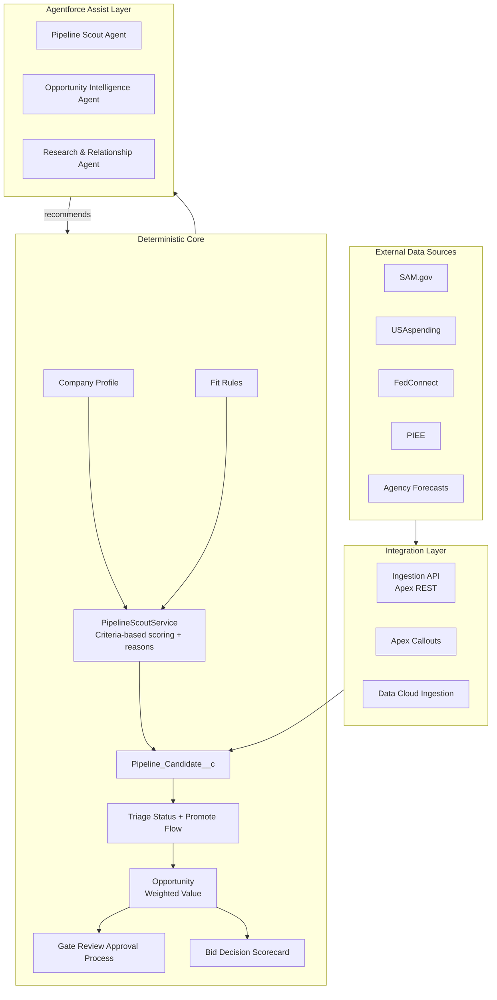

# Nexsus GovSearch Architecture

## Overview

Nexsus GovSearch is a Salesforce-native solution that surfaces best-fit government contracting opportunities, supports structured capture, and provides Agentforce assistance — all inside Lightning Experience.

**Design principle**: Deterministic core + Agentforce assist layer.

- Scoring, triage, routing, and gate decisions are rules-based, auditable, and reproducible.
- Agentforce agents explain scores, generate briefs, suggest actions, and draft plans. Users accept or edit the output.

## Deterministic Core

| Component | Responsibility |
|-----------|----------------|
| Company Profile + Fit Rules | Configurable match criteria (NAICS, PSC, set-asides, vehicles, agencies) |
| PipelineScoutService | Evaluates matches only; writes score, strategic fit, and Score Reasons |
| Triage Status + Promote Flow | Explicit Promote / Watch / Dismiss; creates Opportunity on Promote |
| Gate Review Approval Process | Checklist, approver, and approval before stage advance |
| Bid Decision Scorecard | Weighted criteria and formula recommendation |
| Opportunity Weighted Value | TCV × pWin × pGo; history tracking on pWin |

## Agentforce Assist Layer

| Agent | Role |
|-------|------|
| **Pipeline Scout** | Explains Score Reasons, surfaces high-fit candidates, suggests promotion |
| **Opportunity Intelligence** | Generates AI briefs; references score, gates, and bid recommendation |
| **Research & Relationship** | Identifies contacts, supports competitive analysis, helps draft call plans |

Agents do not own scoring, routing, or gate decisions.

## Data Model (High-Level)

- **Pipeline_Candidate__c**: AI-qualified candidate with External_Id__c, Triage Status, Score Reasons
- **Company_Profile__c** + **Fit_Rule__mdt**: Scoring configuration
- **Opportunity** (extended): AI score, Strategic Fit, pWin, pGo, Weighted Value
- **Gate_Review__c**, **Bid_Decision_Scorecard__c**, **Capture_Plan__c**
- **Solicitation__c**, **Award__c**, **Contract_Vehicle__c**
- **Agency_Hierarchy__c** / **Government_Contact__c**
- **Integration_Log__c**: Structured logging

See [data-model.md](data-model.md) for field-level details.

## Integration Patterns

- **Ingestion API** (`PipelineCandidateIngestionService`): Push model for external systems / MuleSoft
- **Apex Callouts** (`PipelineScoutCalloutService`): Pull model using Named Credentials
- **Data Cloud** or **MuleSoft** for higher-volume or complex scenarios
- All paths log via `IntegrationLogger` to `Integration_Log__c` and trigger scoring

## Security & Compliance

- Designed for Government Cloud / FedRAMP considerations
- Field-level security, sharing rules, and agent user permissions
- Audit trail via Integration Logs, Score Reasons, Field History, and Approval Processes
- No model training on sensitive customer or government data
- Agentforce uses the Einstein Trust Layer

## UI Pattern

- Custom Lightning App: Nexsus GovSearch
- LWC components: `pipelineCandidateList` (dashboard with summary cards and triage), `opportunityAiBriefCard`
- Agentforce panel on record pages

## Diagrams

See [diagrams.md](diagrams.md) for updated architecture, user workflow, scoring workflow, and deterministic-vs-Agentforce diagrams.
