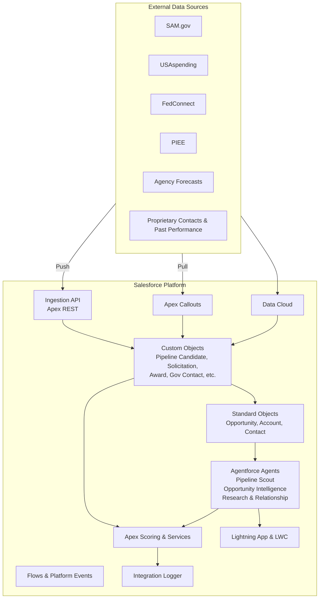

# Nexsus GovSearch Architecture

## Overview

Nexsus GovSearch is a Salesforce-native Agentforce solution that surfaces AI-optimized government contracting opportunities, generates expert briefs, and provides relationship and market intelligence — all inside Lightning Experience.

## Core Agents (Agentforce)

| Agent | Purpose | Key Topics / Actions |
|-------|---------|----------------------|
| **Pipeline Scout** | Score and recommend best-fit Pipeline Candidates | Score candidates, Filter by NAICS/agency, Alert on high-score leads, Convert to Opportunity |
| **Opportunity Intelligence** | Generate AI-authored briefs | Generate Brief, Analyze Incumbent, Identify Whitespace, Prioritize Pursuit |
| **Research & Relationship** | Market analysis and contacts | Find Key Decision Makers, Build Call Plan, Competitive Analysis |

## Data Model (High-Level)

- **Pipeline_Candidate__c**: AI-qualified candidate (recompete, solicitation, task order) with External_Id__c for upserts
- **Opportunity** (extended): AI_Relevancy_Score__c, Strategic_Fit__c, Incumbent__c, Pursuit_Priority__c, AI_Brief_Summary__c, NAICS_Tags__c
- **Solicitation__c**, **Award__c**, **Contract_Vehicle__c**
- **Agency_Hierarchy__c** / **Government_Contact__c**
- **Past_Performance_Profile__c**, **Strategic_Objective__c**
- **Integration_Log__c**: Structured logging for integrations and scoring

See [data-model.md](data-model.md) for field-level details.

## Integration Patterns

- **Ingestion API** (`PipelineCandidateIngestionService`): Push model for external systems / MuleSoft
- **Apex Callouts** (`PipelineScoutCalloutService`): Pull model using Named Credentials
- **Data Cloud** or **MuleSoft** for higher-volume or complex scenarios
- All paths log via `IntegrationLogger` to `Integration_Log__c` and trigger scoring

## Security & Compliance

- Designed for Government Cloud / FedRAMP considerations
- Field-level security, sharing rules, and agent user permissions
- Audit trail via Integration Logs and Salesforce audit features
- No model training on sensitive customer or government data

## UI Pattern

- Custom Lightning App: Nexsus GovSearch
- LWC components: `pipelineCandidateList` (dashboard with summary cards), `opportunityAiBriefCard`
- Agentforce panel on record pages

Mockups are described in [mockups.md](mockups.md).
