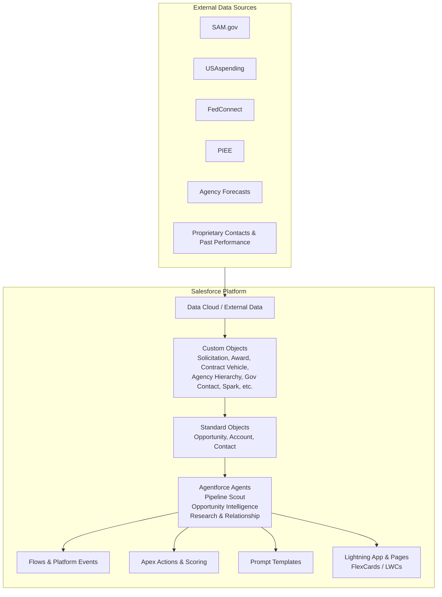

# Nexsus GovSearch Architecture

## Overview

Nexsus GovSearch is a Salesforce-native Agentforce solution that surfaces AI-optimized government contracting opportunities, generates expert briefs, and provides relationship and market intelligence — all inside Lightning Experience.

## Core Agents (Agentforce)

| Agent | Purpose | Key Topics / Actions |
|-------|---------|----------------------|
| **Pipeline Scout** | Score and recommend best-fit recompetes, solicitations, and task orders based on past performance & strategic objectives | Score Opportunity, Create Spark, Filter by NAICS/PSC/Vehicle, Alert on high-score leads |
| **Opportunity Intelligence** | Generate AI-authored briefs on Opportunity / Award / Contract Vehicle records | Generate Brief, Analyze Incumbent, Identify Whitespace, Prioritize Pursuit, Summarize Documents |
| **Research & Relationship** | Market analysis, competitor intelligence, partner matchmaking, contact & org chart insights | Find Key Decision Makers, Build Call Plan, Competitive Spend Analysis, Teaming Recommendations |

Agents run with least-privilege agent users (or user context where appropriate), use Atlas Reasoning Engine, RAG over Data Cloud + attached documents, and require human confirmation for record updates.

## Data Model (High-Level)

- **Opportunity** (extended): AI_Relevancy_Score__c, Strategic_Fit__c, Incumbent__c, Pursuit_Priority__c, AI_Brief_Summary__c, NAICS/PSC tags
- **Spark__c**: Qualified lead before Opportunity conversion
- **Solicitation__c**, **Award__c**, **Contract_Vehicle__c**
- **Agency_Hierarchy__c** / **Government_Contact__c**: Org charts and decision makers
- **Past_Performance_Profile__c**, **Strategic_Objective__c**
- Junctions for partners, documents, notices

See [data-model.md](data-model.md) for field-level details.

## Integration Patterns

- Scheduled Apex / Platform Events / MuleSoft for ingesting federal data
- Data Cloud for harmonized external + Salesforce data used by agents
- Prompt Templates + Generative AI for briefs and summaries
- Lightning Web Components / FlexCards for scored lists, org charts, and embedded Agentforce panels

## Security & Compliance

- Designed for Government Cloud / FedRAMP considerations
- Field-level security, sharing rules, and agent user permissions
- Audit trail on AI-generated actions
- No model training on sensitive customer or government data

## UI Pattern

Standard Lightning console layout with:
- Persistent Agentforce panel (right sidebar)
- Custom app navigation: Pipeline | Opportunities | Awards | Contacts & Org Charts | Research
- Personalized views by business unit / program
- One-click “Add as Spark” / “Convert to Opportunity”

Mockups of the key pages are in [mockups.md](mockups.md).
