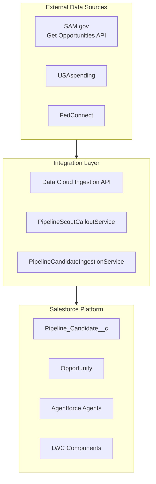

# Nexsus GovSearch Diagrams

Visual workflow and architecture diagrams (JPG). High-resolution images for presentations and documentation.

## Architecture Diagram

Shows external sources (SAM.gov, USAspending, FedConnect) flowing through the Integration Layer (Data Cloud Ingestion API, Apex Callout, Apex REST) into the Salesforce Platform (Pipeline_Candidate__c, Opportunity, Agentforce Agents, LWC Dashboard).

## Pipeline Scout User Workflow

BD user path: Open app → View AI-scored dashboard → Review high-score candidates → Decide Pursue or Disqualify → Convert to Opportunity → View AI Brief → Build Call Plan.

## SAM.gov to Data Cloud Ingestion Sequence

Sequence: Middleware calls SAM.gov API → Transform → POST to Data Cloud Ingestion API → CRM Sync to Pipeline_Candidate__c → Score via PipelineScoutService → Ground Agentforce agents.

## Hybrid SAM.gov Ingestion Strategy

Agency-level API filters (Agency, Date Window, NAICS) → Land in Data Cloud / Pipeline_Candidate__c → Downstream team filtering, list views, scoring, and Agentforce in Salesforce.

## Notes

- JPG diagrams are intended for `docs/diagrams/`.
- Generated to match the Nexsus GovSearch solution design.
- Update or regenerate as the architecture evolves.

## Mermaid Source (for editing)

The Mermaid versions below can be used to regenerate or edit the diagrams.

### High-Level Architecture

