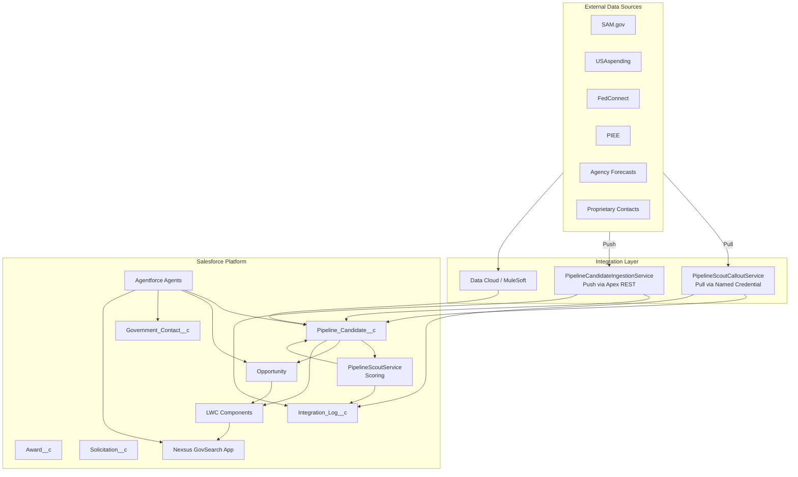
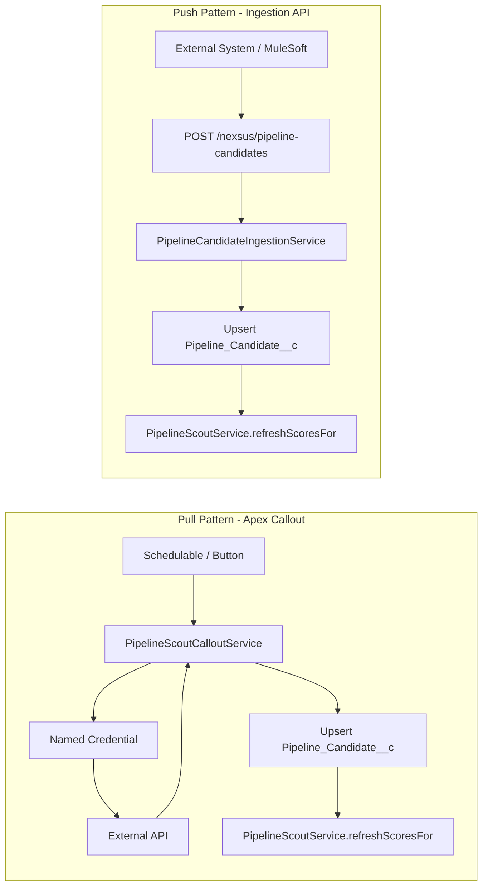
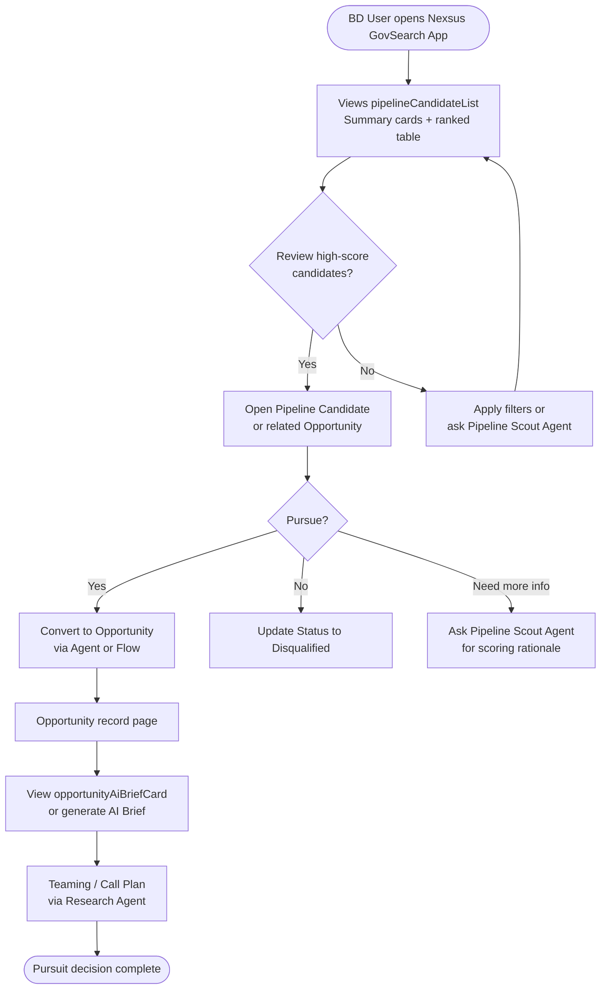
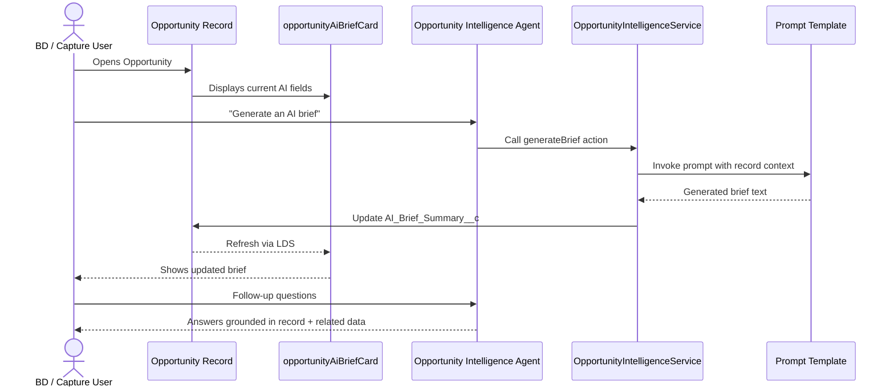
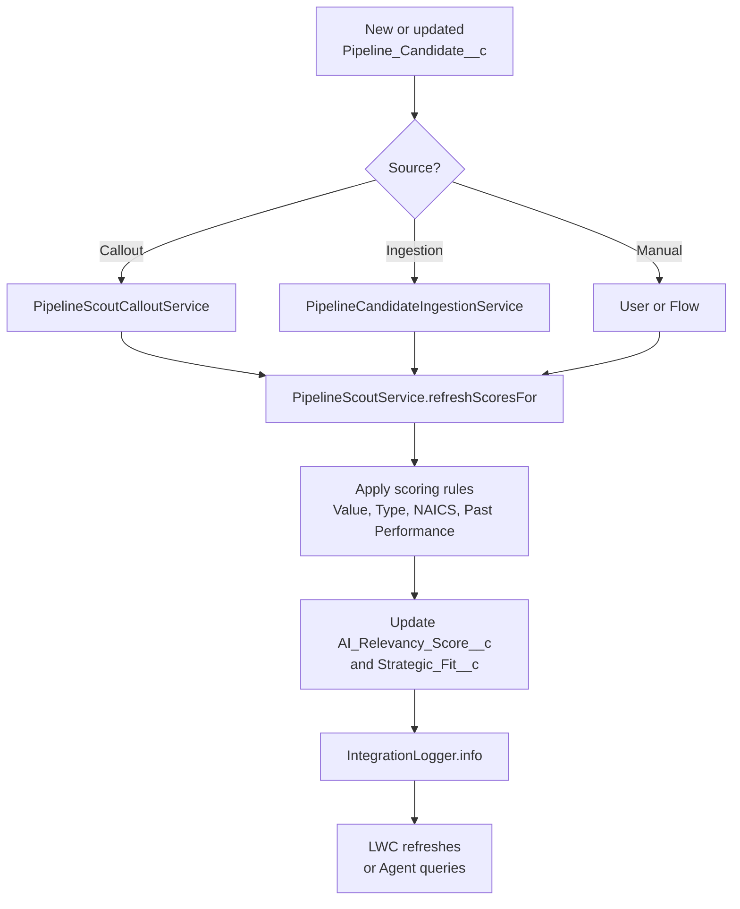
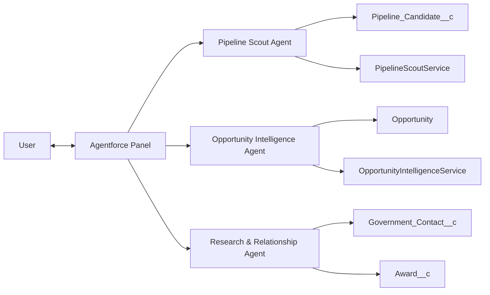
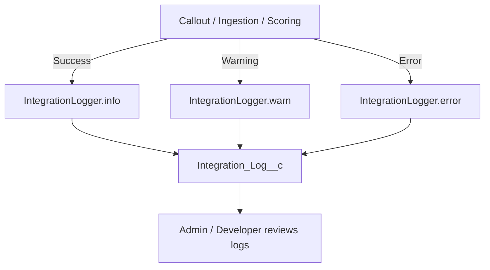

# Nexsus GovSearch Diagrams

This document contains Mermaid diagrams for architecture, user workflows, data flows, and supporting processes. They render natively on GitHub.

## 1. High-Level Architecture

## 2. Data Ingestion Workflows

## 3. Pipeline Scout User Workflow

## 4. Opportunity Intelligence Workflow

## 5. Scoring Process

## 6. Agentforce Interaction Overview

## 7. Logging & Error Handling

## Usage Notes

- These diagrams are written in Mermaid and render on GitHub and in many Markdown viewers.
- Update them as the solution evolves (e.g., when real past-performance scoring logic is added).
- For formal architecture reviews, export the Mermaid diagrams to images using the Mermaid Live Editor or a CI tool.
